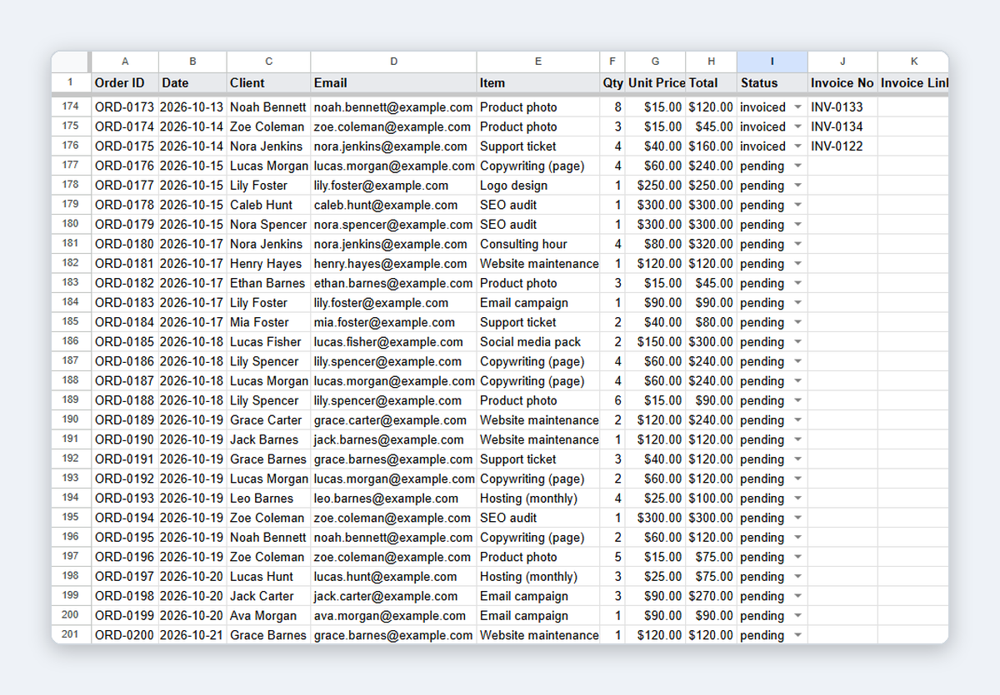
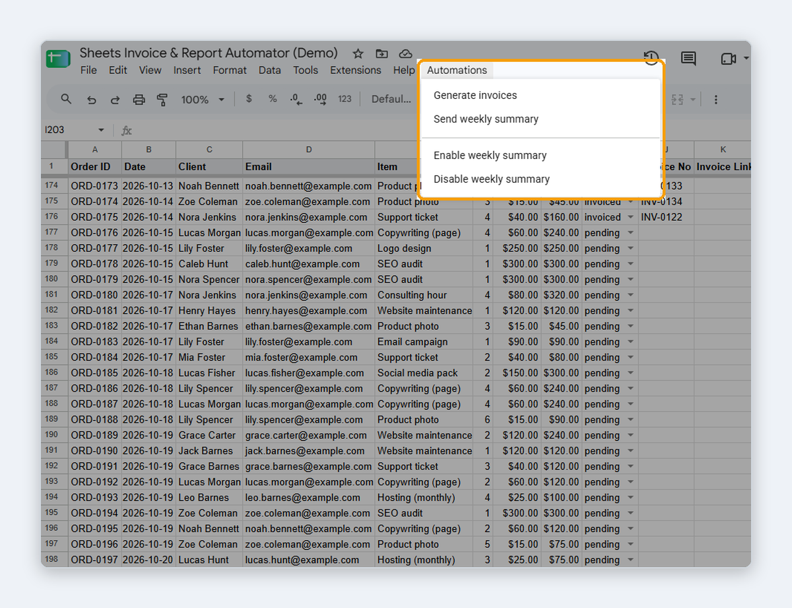
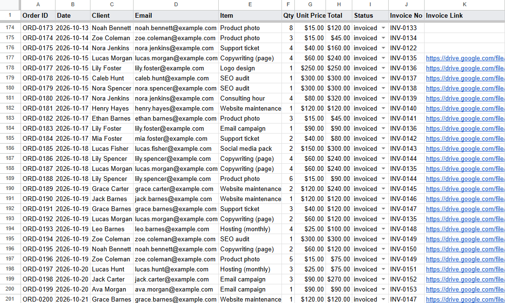
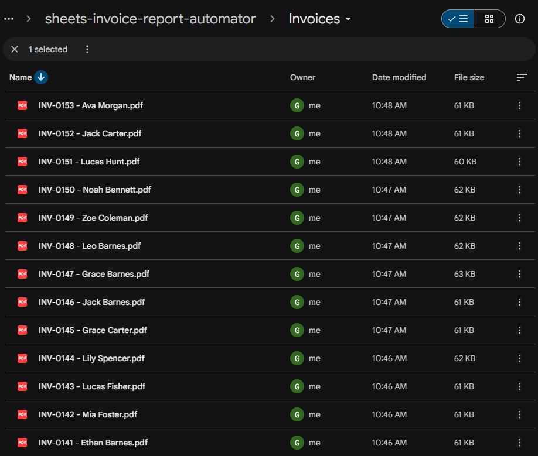
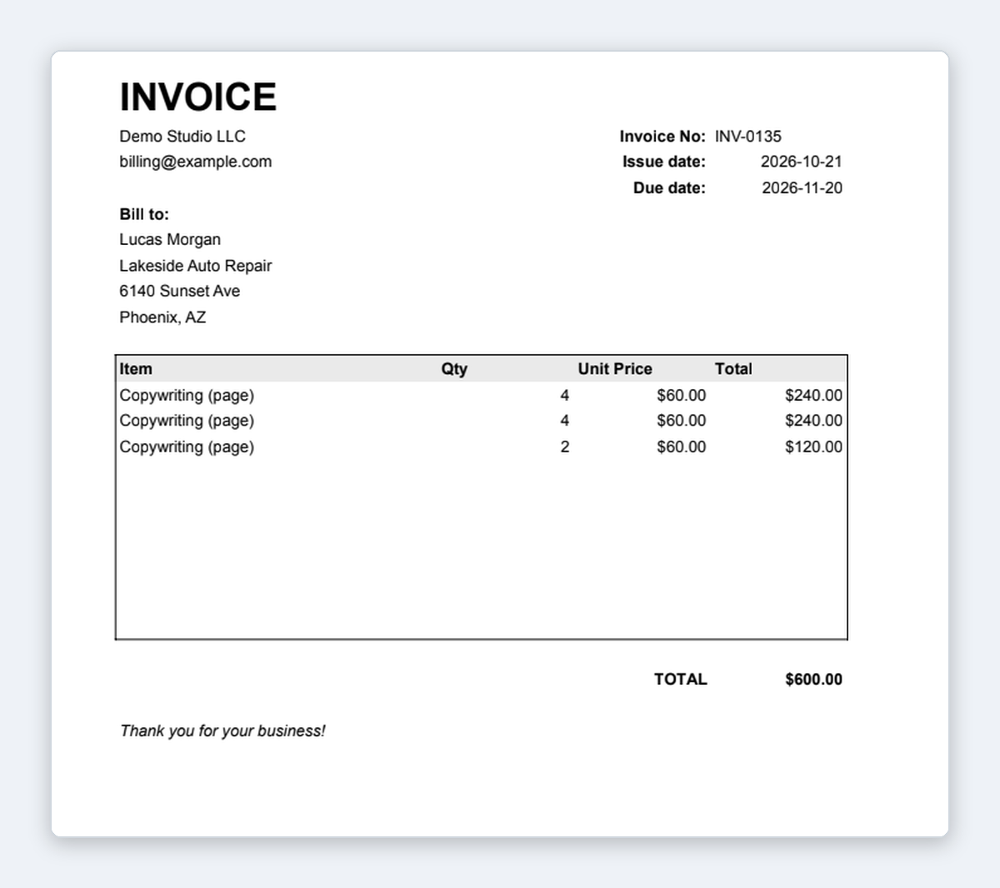
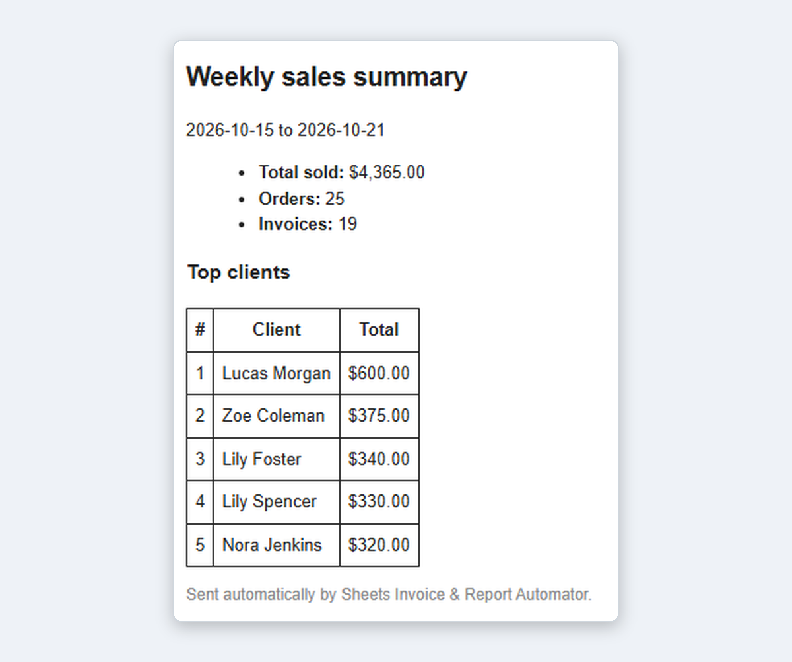

# Sheets Invoice & Report Automator

Google Sheets + Apps Script automation that turns a simple order sheet into PDF invoices saved to Google Drive, and emails a weekly sales summary to the sheet owner.

**Problem it solves:** small businesses often track orders in a spreadsheet and build invoices and reports by hand. This tool does it from a custom menu: one click generates one PDF invoice per client, saves it to Drive, and marks the orders as invoiced.

> **Demo sheet:** [make a copy](https://docs.google.com/spreadsheets/d/1KCuHFT8yuThRFFD3pcZJ5oPdTvyj76O7GvYCv47zDbY/copy) (all data is fictional: 50 clients, 200 orders, emails on `example.com`).

## Features

- **Custom menu:** an **Automations** menu inside Google Sheets, with no web app or add-on to install.
- **PDF invoices:** one invoice per client with `pending` orders, built from an `Invoice Template` tab and exported as a PDF (letter, portrait).
- **Drive storage:** PDFs are saved to an `Invoices` folder next to the spreadsheet, which is created automatically if missing. Files are named `INV-0135 - Client Name.pdf`.
- **Order tracking:** each invoiced order gets status `invoiced`, the invoice number, and a link to the PDF.
- **Resume after failure:** each client is marked right after its PDF is saved, so an interrupted run continues where it stopped.
- **Rate-limit handling:** if Google answers 429 (too many exports), the script retries with a growing delay (5s, 10s, 20s, 40s).
- **Weekly summary email:** total sold, number of orders and invoices, and the top 5 clients of the last 7 days, sent as an HTML email.
- **Optional weekly trigger:** sends the summary every Monday morning. It is turned on or off from the menu.

## Screenshots

### 1. Before: orders are pending

Orders from the last 7 days have status `pending`, with no invoice yet.

### 2. One-click Automations menu

All actions run from a custom menu inside Google Sheets.

### 3. After: orders are invoiced

After **Generate invoices**, each order has status `invoiced`, an invoice number, and a link to its PDF.

### 4. PDFs saved to Google Drive

One PDF per client, saved to the `Invoices` folder next to the spreadsheet.

### 5. Generated invoice

Bill-to data, items, total, and due date (Net 30), filled from the `Invoice Template` tab.

### 6. Weekly summary email

Total sold, orders, invoices, and top 5 clients of the last 7 days.

## How it works

1. **Generate invoices** groups the `pending` orders by client.
2. For each client, it fills the `Invoice Template` tab (bill-to data, items, total, issue date, due date Net 30) and exports only that tab as a PDF.
3. The PDF is saved to the `Invoices` folder, and the client's orders are updated with status, invoice number, and link.
4. The next invoice number is the highest existing one + 1 (`INV-0001`, `INV-0002`, ...).
5. **Send weekly summary** reads the orders from the last 7 days (any status) and emails the totals to the spreadsheet owner.

Columns are found by header name, not by position, so the column order in `Orders` can change.

## Tech Stack

- Google Sheets
- Google Apps Script (V8 runtime)
- Apps Script services: SpreadsheetApp, DriveApp, UrlFetchApp (PDF export), MailApp, ScriptApp (trigger)

## Project structure

| File | Purpose |
| --- | --- |
| `Code.gs` | Builds the **Automations** menu (`onOpen`). |
| `Invoices.gs` | Generates the PDF invoices and updates the orders. |
| `Summary.gs` | Weekly summary email and the enable/disable trigger. |
| `Setup.gs` | `setupDemo()`: creates the three tabs with fictional data. |
| `appsscript.json` | Apps Script manifest (time zone, runtime). |

## Sheet structure

- **Orders:** Order ID, Date, Client, Email, Item, Qty, Unit Price, Total, Status, Invoice No, Invoice Link
- **Clients:** Client, Email, Company, Address, City
- **Invoice Template:** issuer info, invoice number and dates, bill-to block, up to 10 item lines, and total

## Setup

**Option 1: copy the demo sheet (easiest)**

1. Open the [demo sheet](https://docs.google.com/spreadsheets/d/1KCuHFT8yuThRFFD3pcZJ5oPdTvyj76O7GvYCv47zDbY/edit?usp=sharing) and choose **File → Make a copy**. The script is copied with the sheet.
2. Open your copy and reload the page. The **Automations** menu appears next to **Help**.
3. The first time you run a menu item, Google asks for permissions (Sheets, Drive, external requests for the PDF export, email, triggers). Because the script is not published by Google, click **Advanced → Go to project (unsafe)** to allow it.

**Option 2: start from the code**

1. Create a new Google Sheet and open **Extensions → Apps Script**.
2. Create the files from this repository (`Code.gs`, `Invoices.gs`, `Summary.gs`, `Setup.gs`) and paste their content.
3. To edit the manifest, enable **Project Settings → Show "appsscript.json" manifest file in editor**, and paste `appsscript.json`.
4. Run `setupDemo()` once from the editor to create the tabs with demo data, then reload the sheet.

## Usage

- **Automations → Generate invoices:** creates the PDFs for all `pending` orders.
- **Automations → Send weekly summary:** sends the summary email now.
- **Automations → Enable weekly summary:** creates a trigger for every Monday, 8–9 AM in the script's time zone. Running it again replaces the old trigger instead of creating a duplicate.
- **Automations → Disable weekly summary:** removes the trigger.

To reset the demo, run `setupDemo()` from the editor. It rewrites the three tabs with the same fictional data (fixed seed), using dates relative to today.

## Limitations

- **10 items per invoice:** the template has 10 item lines. Clients with more pending orders would need pagination, which is not implemented.
- **Export limits:** Google limits how fast PDFs can be exported. The script waits 2s between invoices and retries on 429, so large batches are slow (about 5–6 seconds per invoice).
- **6-minute execution limit:** Apps Script stops a run after 6 minutes. Very large batches may need more than one run, and the script resumes where it stopped.
- **Email quota:** MailApp has a daily sending quota (lower on free Gmail accounts). It sends one email per summary, so this is not an issue for normal use.
- **Single currency and language:** USD and English only. Company details are set in the `Invoice Template` tab.
- **No payments or client emails:** invoices are not sent to clients or connected to payment systems.

## Privacy

All data in the demo is fictional. The code contains no personal emails, folder IDs, or keys. The summary email is sent to the account that runs the script.

## Author

Gabriel Fantin - [GitHub](https://github.com/gabrielbf7)